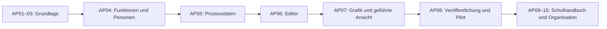

# Roadmap: Schulwissen als Wissensbasis und Prozesswerkzeug

Stand: 31.10.2026. Ausgangspunkt: Produktanalyse in Commit `8d4a9d7`, bestehende Anwendung einschließlich Protokollfreigabe und begrenzter Übersichten. Den tatsächlichen Umsetzungsstand zeigen die Paketstatus und das Übergabeprotokoll.

**Nächstes Arbeitspaket: AP08.**

Einstieg für die nächste Sitzung: „Arbeite das nächste offene, durch seine Abhängigkeiten freigegebene Paket der ROADMAP.md ab und aktualisiere anschließend Status und Übergabeprotokoll.“

## 1. Verbindlicher Schwerpunkt

Der Nutzer wünscht ausdrücklich ein Werkzeug, mit dem die Schule Arbeitsabläufe definieren und als „Was passiert, wenn …?“-Grafik veranschaulichen kann. Prozessschritte benennen Funktionen wie **Sonderpädagogin**, deren Besetzung im Backend aus dem vorhandenen Nutzerstamm erfolgt. Alle Lehrkräfte können die für das Kollegium freigegebenen Abläufe aufrufen.

Der erste nutzbare Prozesseditor wird vor Jahreskalender, Aufgabenverwaltung und weiterem Fachausbau fertiggestellt. Sicherheits- und Integritätslücken des aktuellen Fundaments werden vorher geschlossen. Das Werkzeug bleibt eine Hilfe zum Nachschlagen allgemeiner Abläufe; es führt keine personenbezogenen Schülerfälle aus.

Grundlagen:

- [Produktanalyse](docs/PRODUKTANALYSE_GRUNDSCHULE.md): Befunde und Informationslandkarte.
- [Spezifikation des Prozesswerkzeugs](docs/PROZESSWERKZEUG.md): fachliche und technische Entscheidungen für AP04–AP08.
- [SPEC.md](SPEC.md): bestehende Funktionen und Grenzen. Die Roadmap beschreibt geplante Erweiterungen, insbesondere andere fachliche Freigabewege und Schulhandbuchtypen.
- [DESIGN.md](DESIGN.md): bestätigte Gestaltung, Schulgrün und Duzen. Die bereits freigegebene Richtung weiterverwenden.
- [Bisheriger Protokollworkflow](docs/protokoll-workflow.md): gegen Regressionen schützen.

## 2. Arbeitsweise für kommende Coding-Sitzungen

1. Zu Beginn `git status`, vorhandene Projektanweisungen, diese Roadmap und die betroffenen Ist-Implementierungen lesen. Versionsangaben hier sind eine Ausgangsbasis, keine Aufforderung, auf einen alten Commit zurückzugehen.
2. Ohne genauer bezeichnetes Ziel das erste geplante Paket mit erfüllten Abhängigkeiten bearbeiten. Ein Paket ist eine zusammenhängende Einheit; es darf mehrere Sitzungen brauchen. Keine festen Stundenschätzungen voraussetzen.
3. Status nur nach tatsächlichem Fortschritt ändern: **geplant → in Arbeit → fertig**, gegebenenfalls mit konkret dokumentiertem Hindernis. Keine Fertigmarkierung ohne Abnahmekriterien.
4. Pro Sitzung das konkrete Ziel eingrenzen, implementieren und angemessen prüfen. Sinnvolle Regressionstests für Rechte, Fassungen, Datenintegrität und Prozesslogik ergänzen. Für UI Änderungen Tastatur und 390/768/1024/1440 Pixel prüfen, Screenshots bei 1440/768 Pixeln in `docs/screenshots/` ablegen.
5. Keine produktiven Schultexte, Funktionsbesetzungen oder Gremienentscheidungen erfinden. Beispiele nur in Tests oder ausdrücklich gekennzeichneten Demonstrationen. Bestehende Daten nicht für eine schönere Vorschau umschreiben.
6. Vorhandene Django-/HTMX-/Alpine-Struktur, Registry, Schreibdienste und Versionshistorie weiterverwenden. Kein separates Prozess-Silo mit eigener, widersprüchlicher Freigabelogik errichten.
7. Änderungen, verbleibende Aufgaben, tatsächliche Prüfungen und Migrationen in dieser Datei dokumentieren. Mit deutscher Commit-Nachricht sichern; bestehende fremde Änderungen erhalten.
8. Eine Sitzung endet mit einem nachvollziehbaren Zwischenstand. Bereits autorisierte Arbeit benötigt keinen pauschalen neuen Freigabestopp. Echte fachliche Entscheidungen und fehlende Zugangsdaten konkret benennen; unabhängige Arbeit fortsetzen.

**Definition „fertig“:** Abnahmekriterien erfüllt, passende Tests grün, notwendige Migrationen vorhanden und geprüft, relevante Rollen und UI Zustände berücksichtigt, Dokumentation und Übergabe aktualisiert. „Technisch fertig“ ersetzt keine fachliche Freigabe eines echten schulischen Verfahrens.

## 3. Meilensteine und Reihenfolge

| Meilenstein | Pakete | Nutzbarer Stand |
| --- | --- | --- |
| M1: verlässliche Grundlage | AP01–AP03 | Gleiche Lesefassung in allen Zugängen, klar abgegrenzte Rechte, geschützte Zusammenarbeit |
| M2: Prozesswerkzeug | AP04–AP08 | Funktionen aus dem Nutzerstamm besetzen, Prozesse erstellen, grafisch/geführt lesen, freigeben und drucken |
| M3: gepflegtes Schulhandbuch | AP09–AP10 | Gültigkeit und Dateien absichern, Vorlagen und Pflegeverantwortung im Schulalltag nutzen |
| M4: schulische Organisation | AP11–AP12 | Fachliche Beschlüsse, Folgeaufträge und wiederkehrender Jahreslauf |
| M5: Breite und Orientierung | AP13–AP15 | Weitere Fächer, Einarbeitung, aktuelle Änderungen und Schulentwicklung |
| Betriebsfreigabe | B01–B02 | Nachgewiesener Betrieb und kontrollierte Übernahme des Bestandswissens |

B01 wird parallel geplant und vor dem verbindlichen breiten Produktiveinsatz abgenommen. Fehlende Nextcloud-Zugänge blockieren weder lokale Entwicklung noch Tests mit lokalen Konten. OIDC ist optional.

## 4. Abarbeitbare Pakete

### AP01 — Lesefassungen und Suchsichtbarkeit vereinheitlichen

**Status:** fertig (31.10.2026). **Abhängigkeiten:** keine.

- Den bestätigten Befund beheben: Treffer dürfen für „Lesend“ keine Titel, Status oder Ausschnitte des neueren Arbeitsstands zeigen.
- Eine gemeinsame Auflösung der für Nutzer und gewünschten Stand sichtbaren Fassung einführen beziehungsweise vorhandene Helfer zusammenführen.
- Suche, Vorschläge, Kontextpfade, Rückverweise, Filter und Trefferzahlen sowie Anhänge und Exporte prüfen. Veröffentlichung eines Eintrags darf andere unzulässige Metadaten nicht nebenbei sichtbar machen.
- An Lesefassungen angemessene Indizes/Abfragen anbinden; aktuelle und freigegebene Texte nicht ununterscheidbar ausgeben.

**Abnahme:** Eine freigegebene Fassung mit abweichendem geheim gehaltenem Test-Arbeitsstand liefert Lesenden überall ausschließlich erlaubte Angaben; Bearbeitende können den Arbeitsstand weiter nutzen. Tests prüfen Inhalte und Metadaten, nicht nur Kennungen. Nicht erlaubte Rückverweise fehlen auch als Titel oder Zählung.

**Berührungspunkte:** `kern/rechte.py`, `kern/views.py`, `suche/`, `kern/suchindex.py`, `eintragstypen/dienste.py`, Exporte und Anhangzugriffe.

**Ergebnis:** Gemeinsame Lesefassung und getrennte Fassungsindizes einschließlich Migration, sichere Kontext-/Zielbeschriftungen, Rückverweise, Zählungen und Dateiabrufe umgesetzt. Abnahme und Hinweise zur nginx-Aktualisierung: [AP01_LESEFASSUNGEN.md](docs/AP01_LESEFASSUNGEN.md).

### AP02 — Dokumentzugänge und redaktionelle Bereiche

**Status:** fertig (31.10.2026). **Abhängigkeiten:** AP01.

- Lesen, Bearbeiten und fachlich Freigeben getrennt modellieren; Zugänge für Dokumente/Bereiche und redaktionelle Zuständigkeiten ergänzen.
- Bestehende kollegiumsweite Inhalte in der Migration weiterhin für das Kollegium verfügbar halten. Gruppenmitgliedschaft und Zuständigkeit nicht ungeprüft als Leseberechtigung interpretieren.
- Normale Lehrkräfte können kollegiumsweit freigegebene Prozesse später lesen; eine Schulfunktionsbesetzung verleiht keine technischen Sonderrechte.
- Oberfläche und APIs einschließlich Suche, Download und Django-Verwaltung auf dieselben Entscheidungen stützen.

**Abnahme:** Eine für Deutsch zuständige Redaktion erhält dadurch keine fremden redaktionellen Bereiche. OGS/Lesend sehen ausschließlich erlaubte Inhalte. Anonyme und unberechtigte Zugriffe, direkte URLs, Vorschläge und Dateien werden getestet. Vorhandene Arbeitspläne bleiben erreichbar.

**Ergebnis:** Wissensbereiche und getrennte Lese-/Bearbeitungs-/Freigaberegeln für Nutzer oder Gruppen; zentrale Prüfung für Zugriffe und Verwaltungswege; dauerhafte Beschlussrahmen und Bestandsmigration. Einrichtung und Abnahme: [AP02_DOKUMENTZUGAENGE.md](docs/AP02_DOKUMENTZUGAENGE.md).

### AP03 — Gemeinsames Schreiben ohne stilles Überschreiben

**Status:** fertig (31.10.2026). **Abhängigkeiten:** AP01; vor dem gemeinsamen Prozesseditor abschließen.

- Im normalen Schreibweg eine erwartete Ausgangsversion prüfen und den Vergleich samt Speicherung atomar durchführen.
- Bei Konflikt Eingaben erhalten, verständlichen Hinweis und Vergleich anbieten. Kein automatisches Ersetzen fremder Änderungen.
- Die vorhandene Standprüfung der Protokollgenehmigung erhalten. Import- und Verwaltungswege bewusst berücksichtigen.

**Abnahme:** Zwei gleichzeitig geöffnete Formulare können widersprüchliche Änderungen nicht unbemerkt überschreiben. Der zweite Bearbeiter kann seine Eingabe wiederverwenden. Bereits freigegebene Fassungen bleiben unverändert. Der spätere grafische Editor nutzt denselben Schutz.

**Ergebnis:** Signierter Ausgangsstand, atomare Prüfung im gemeinsamen Schreibdienst, Vergleich mit erhaltener Eingabe und ausdrücklich bestätigte Auflösung; Verwaltung und Importvorschau geschützt. Details und Schnittstelle für den Prozesseditor: [AP03_SCHREIBSCHUTZ.md](docs/AP03_SCHREIBSCHUTZ.md).

### AP04 — Schulfunktionsrollen und Besetzung aus dem Nutzerstamm

**Status:** fertig (31.10.2026). **Abhängigkeiten:** AP02.

- Schulfunktionsrollen unabhängig von Berechtigungsrollen und Arbeitsgruppen anlegen, etwa Sonderpädagogin, Schulleitung, IT-Ansprechperson oder Ganztagskoordination.
- Besetzungen mit Verweis auf das bestehende `Nutzer`-Modell im Backend verwalten: Aufgabe, Person, Hauptzuständigkeit/Vertretung, zeitliche Gültigkeit und gegebenenfalls Geltungsbereich.
- Aktive Nutzer per Suche/Autocomplete auswählen. Konten nicht für jede Funktion duplizieren; eine Person darf mehrere Funktionen haben.
- Vakante, abgelaufene oder durch deaktivierte Konten nicht mehr erreichbare Besetzungen ausdrücklich anzeigen. Mehrere Zuständige bewusst als Team oder getrennte Bereiche unterstützen; nicht zufällig die erste Person auswählen.
- Kleines lesbares Funktionsverzeichnis und zentralen Resolver für spätere Prozessschritte bereitstellen.

**Abnahme:** Eine Funktion wird mit einer vorhandenen Lehrkraft besetzt. Ein Personalwechsel aktualisiert die aktuelle Kontaktanzeige aller verknüpften Abläufe, ohne deren Text zu bearbeiten. Vertretung und Vakanz sind sichtbar; Zuordnung verändert keine Zugriffsrechte. Historische Besetzungen werden nicht überschrieben.

**Ergebnis:** Eigenständige Schulfunktionen, benannte Zuständigkeitsbereiche, Besetzungen mit aktiver Nutzersuche, Vertretung, Team, Personalwechsel und unveränderlicher Historie; lesbares Verzeichnis und zentraler Resolver. Einrichtung und Auflösung: [AP04_SCHULFUNKTIONEN.md](docs/AP04_SCHULFUNKTIONEN.md).

**Details:** [PROZESSWERKZEUG.md, Funktionsmodell](docs/PROZESSWERKZEUG.md).

### AP05 — Versionierbare Prozessdaten und Graphprüfung

**Status:** fertig (31.10.2026). **Abhängigkeiten:** AP01–AP04.

- Eintragstyp `prozess` und einen passenden Schulhandbuch-Dokumenttyp in die Registry aufnehmen. Bestehende Dokumente unverändert weiterführen.
- Start, Handlung, Entscheidung und Ende sowie beschriftete Verbindungen und explizite Rücksprünge modellieren.
- Prozessschritte referenzieren Schulfunktionsrollen, gültige Wissenseinträge und zulässige Formulare/Dateien.
- Struktur und Schema serverseitig prüfen. Unvollständige Entwürfe speichern können; nur vollständige, erreichbare und verständliche Abläufe veröffentlichen.
- Suche, Versionierung, Import-/Export-Schema und unveränderliche freigegebene Stände berücksichtigen. Keine zweite unabhängige Versionshistorie einführen.

**Abnahme:** Ein Testablauf mit Ja-/Nein-Verzweigung lässt sich speichern und als Fassung vergleichen. Fehlende Ziele, unerreichbare Knoten, doppelte IDs und Kreise ohne Ausgang verhindern die Freigabe. Unzulässige Zielverweise geben keine fremden Inhalte preis.

**Ergebnis:** Registry-Typ Prozess und Schulhandbuch, begrenztes Graphschema, Entwurfs-/Freigabeprüfung, atomare Freigaben und gemeinsame Referenzschnappschüsse umgesetzt. Datenvertrag, technische Wege und Editor-Übergabe: [AP05_PROZESSDATEN.md](docs/AP05_PROZESSDATEN.md).

### AP06 — Prozesseditor mit automatischer Vorschau

**Status:** fertig (31.10.2026). **Abhängigkeiten:** AP03 und AP05.

- Eine verständliche Autorenoberfläche für Schulleitung und berechtigte Redaktion bauen: Schritt hinzufügen, Art wählen, Frage/Handlung eintragen, Funktion auswählen und Folgeschritte verbinden.
- Verzweigungen standardmäßig mit „Ja“/„Nein“ anbieten, weitere eindeutige Auswahlmöglichkeiten ermöglichen.
- Änderungen in einer automatisch erzeugten grafischen Vorschau sichtbar machen. Keine Kenntnis einer Diagrammsprache verlangen.
- Verbindungen über auswählbare Folgeschritte bearbeiten; Maus und Touch unterstützen, ohne Drag-and-drop vorauszusetzen. Tastaturbedienung und stabile Knoten-IDs erhalten.
- Prüfung mit Sprung zum betroffenen Schritt, Entwurfsspeicherung und Konfliktschutz integrieren.

**Abnahme:** Ein berechtigter Nutzer kann über die Oberfläche einen vollständigen verzweigten Beispielprozess erstellen und ändern. Nach Neuladen sind Texte, Funktionen und Verbindungen erhalten. Fehler erklären den nächsten Korrekturschritt. Bearbeitung funktioniert bei 768 Pixeln und mit Tastatur.

**Ergebnis:** Bedienbarer Schritteditor mit Ja/Nein und weiteren Antworten, Funktions-/Bereichs- und Materialauswahl, Wiederherstellung entfernter Schritte, nativer SVG-Vorschau, Textalternative und schreibfreier Serverprüfung. Eingaben bleiben bei Fehlern und Schreibkonflikten erhalten. Anleitung und technische Übergabe: [AP06_PROZESSEDITOR.md](docs/AP06_PROZESSEDITOR.md).

### AP07 — Ablaufgrafik und geführtes „Was passiert, wenn …?“

**Status:** fertig (31.10.2026). **Abhängigkeiten:** AP06.

- Eine lesbare, automatisch angeordnete Ablaufgrafik aus denselben Prozessdaten rendern; Auswahl eines Schritts öffnet Erklärung, aktuelle zuständige Funktion/Person und passende Ressourcen.
- Zusätzlich eine geführte Ansicht anbieten: Frage beantworten, nächsten passenden Schritt sehen, zurückgehen oder neu beginnen.
- Kleine Bildschirme erhalten eine gut bedienbare Schrittansicht; Textalternative und Druckansicht entstehen aus derselben Quelle.
- Entscheidungsantworten bleiben im ersten Stand im Browser-Arbeitsspeicher. Keine personenbezogenen Fälle, Fallakten oder automatischen Tätigkeitsnachweise anlegen.
- Aktuelle Ansprechpartner und archivierte Prozessfassungen verständlich auseinanderhalten.

**Abnahme:** Eine Lehrkraft kann jeden gültigen Zweig durchlaufen, zurückgehen und die zugehörige aktuelle Besetzung erkennen. Derselbe Ablauf wird grafisch und als Text ohne inhaltliche Widersprüche ausgegeben. Rücksprünge verursachen keine endlose Darstellung. Farben sind nicht die einzigen Informationsträger.

**Ergebnis:** Gemeinsame SVG-Grafik, geführte Schrittansicht und Textalternative mit aktuellen Kontakten, rechtegebundenen Materialien und vollständigem Druck/PDF. Antworten bleiben flüchtig im Browser. Anleitung und Abnahmen: [AP07_PROZESSLESEN.md](docs/AP07_PROZESSLESEN.md).

### AP08 — Prozessveröffentlichung und erster schulischer Pilot

**Status:** geplant. **Abhängigkeiten:** AP01–AP07; B01 vor verbindlichem breitem Einsatz.

- Gültiger Lesestand, Arbeitsstand und angemessene fachliche Freigabe für Prozesse sichtbar machen. Eine reine Personenumbesetzung benötigt keine Änderung der freigegebenen Prozesslogik.
- Suche nach Prozess, Anlass und Schulfunktionsrolle anbinden; Verweise, Zugänge und Kontaktauflösung gemeinsam prüfen.
- Freigegebene Prozesse für alle vorgesehenen Lehrkräfte leicht erreichbar machen. Entwurfsbearbeitung und Backend-Besetzung bleiben berechtigungsgesteuert.
- Kurze Demoanleitung und einen vollständigen, ausdrücklich fiktiven Testablauf bereitstellen. Echte Verfahrensinhalte und Personen werden erst nach fachlicher Bestätigung übernommen.
- Bei verbindlichen veränderlichen Dateianhängen schon hier eine nachprüfbare Fassung oder einen deutlichen Prüf-/Änderungsstatus vorsehen; fehlende Absicherung nicht durch eine scheinbar vollständige Freigabe verdecken.

**Abnahme M2:** Prozess im Frontend erstellen → Funktion im Backend mit vorhandenem Nutzer besetzen → Ablauf freigeben → Lehrkraft findet und durchläuft die Grafik → Person wechselt → aktuelle Kontaktanzeige ändert sich, Prozessfassung bleibt erhalten. Export/Druck, Rechte, Konflikte und mobile Ansichten sind geprüft.

**Dies ist der erste vollständige Lieferstand des ausdrücklich gewünschten Prozesswerkzeugs.**

### AP09 — Gültigkeit, Quellen und Wissenspflege ausbauen

**Status:** geplant. **Abhängigkeiten:** AP08.

- Inhaltsart, Verbindlichkeit, Sichtbarkeit und Bearbeitungszustand getrennt behandeln. Angemessene Freigabe ohne Konferenzzwang für jede Routineinformation ermöglichen.
- Wirksam ab/bis, ersetzt durch, letzter Prüfstand und nächster Prüftermin ergänzen; Prüfdatum ist kein automatisches Außerkrafttreten.
- Pflegeverantwortung und Vertretung über Funktionen zuweisen. Übersicht über überfällige Prüfungen und gemeldete Fehler anbieten.
- Freigegebene Anlagen zuverlässig an Dateifassungen binden; dynamische Materiallinks ausdrücklich unterscheiden.

**Abnahme:** Eine künftig wirksame Regel verdrängt die aktuelle nicht vorzeitig. Ein Rollenwechsel übergibt Pflegeaufgaben ohne Kopieren. Ein geänderter normativer Anhang bleibt nicht unbemerkt als unverändert gültig dargestellt.

### AP10 — Schulhandbuch, Formularverzeichnis und zehn häufige Abläufe

**Status:** geplant. **Abhängigkeiten:** AP08–AP09.

- Handbuchnavigation nach schulischen Aufgaben, Kurzantworten und gepflegte Schlagwörter/Synonyme ergänzen.
- Formulare/Vorlagen mit Verwendungszweck, gültigem Stand und Prozessbezug verzeichnen. Erlaubte freigegebene PDFs für Lehrkräfte zugänglich machen; keine pauschalen Rechte auf vollständige Arbeitsstandsexporte vergeben.
- Mit den Verantwortlichen die zehn wichtigsten echten Abläufe aufnehmen und fachlich prüfen. Beispiele aus der Produktanalyse dienen der Auswahl, nicht als ungeprüfte fertige Schulregel.

**Abnahme:** Ausflug, eigene Abwesenheit, IT-Störung und Materialbestellung werden mit der jeweils richtigen Zuständigkeit und Vorlage ohne Kenntnis alter Ordnernamen gefunden. Mehrere Einstiege führen zur selben maßgeblichen Quelle.

### AP11 — Sitzungen, fachliche Beschlüsse und Umsetzungsaufträge

**Status:** geplant. **Abhängigkeiten:** AP09; AP04 für Zuständigkeiten nutzen.

- Genehmigung einer Niederschrift von fachlichen Entscheidungen ihrer Tagesordnungspunkte trennen. Informationen und Beratungen als solche erkennbar halten.
- Agenda/Themeneingabe und Folgeaufträge mit zuständiger Funktion, Termin, Bearbeitungsstand und Ergebnis ergänzen.
- Bestehende Genehmigungen samt Herkunft erhalten; historische Protokolle nicht automatisch in erfundene Einzelbeschlüsse zerlegen.
- Persönliche Häkchen und Notizen der Lehrkräfte nicht zu einem Leitungsmonitor umdeuten.

**Abnahme:** Vom TOP gelangt man zur konkreten Entscheidung, deren Wissenseinträgen und zugehörigen Folgeaufträgen. Ein genehmigter Informationstext erscheint nicht als neu beschlossene Schulregel. Bestehende Freigaben und Rücknahmen funktionieren weiterhin.

### AP12 — Schuljahresfahrplan und wiederkehrende Fristen

**Status:** geplant. **Abhängigkeiten:** AP10–AP11.

- Wiederkehrende schulische Ereignisse mit Vorbereitung, Fristen, zuständigen Funktionen und Prozessbezügen abbilden.
- Jahreswechsel und Vertretung berücksichtigen. Mit vorhandenen Kalendern verbinden, statt ungefragt eine vollständige Stunden-/Vertretungsplanung neu zu bauen.

**Abnahme:** Ein Ereignis wird ins nächste Schuljahr übernommen, seine Inhalte bleiben verlinkt und Termine werden bewusst bestätigt. Zuständige finden anstehende Vorbereitungen. Keine unbestätigten Feiertags-/Ferientermine erfinden.

### AP13 — Fachliche Breite und Planungskontext

**Status:** geplant. **Abhängigkeiten:** AP09; Datenbereitstellung/fachliche Prüfung durch die Schule.

- Amtliche Daten der acht weiteren Fächer kontrolliert importieren; markierte Stufen und offene schulische Festlegungen nachbearbeiten.
- Fachgerechte Felder und jahrgangsübergreifende Lerngruppen unterstützen. Klasse/Schuljahr und mehrere Fachpläne sinnvoll zusammenführen.

**Abnahme:** Fachwechsel zeigt ausschließlich passende Kompetenzen und Felder. Eine jahrgangsübergreifende Gruppe ist abbildbar. Quellen und fachliche Prüfung sind dokumentiert; keine unbekannten Lehrplaninhalte ergänzen, um eine leere Ansicht zu füllen.

### AP14 — Einarbeitung und relevante Änderungen

**Status:** geplant. **Abhängigkeiten:** AP09–AP10.

- Einarbeitungspakete nach Aufgaben und Funktionen, gemerkte Bereiche sowie relevante wesentliche Änderungen anbieten.
- Benachrichtigungen sparsam und nachvollziehbar bündeln; zunächst eine In-App-Übersicht. Externe Nachrichten erst mit bewusst eingerichteter und autorisierter Versandfunktion.

**Abnahme:** Eine neue Kollegin findet erste Schritte, aktuelle Kontakte und Regeln. Nach Abwesenheit findet eine Lehrkraft relevante Änderungen. Keine heimliche Protokollierung individueller Lektüre.

### AP15 — Schulentwicklung und Wissenstransfer

**Status:** geplant. **Abhängigkeiten:** AP11–AP14.

- Ziele, Maßnahmen, Fortbildungswissen, Meilensteine und fachliche Überprüfung verknüpfen.
- Auswertungen auf hinreichend anonymisierte schulische Ergebnisse begrenzen; keine Schüler- oder Personalakten nachbilden.

**Abnahme:** Ein Entwicklungsziel lässt sich über eine Maßnahme bis zur dokumentierten Überprüfung verfolgen; Beteiligte erkennen Verantwortung und nächsten Schritt.

### B01 — Betrieb und gewünschte Dateianbindung nachweisen

**Status:** geplant. **Abhängigkeiten:** paralleler Betriebsstrang; echte Zugangsdaten und Zielbetrieb erforderlich.

- Nextcloud-Zugriffe mit einem passend begrenzten technischen Konto einrichten und Rechte zwischen Dateisystem und Wissensbasis prüfen.
- Lokale Konten erhalten; OIDC bei tatsächlichem Bedarf anbinden. Keine Zugangsdaten in Dokumentation oder Git ablegen.
- Automatische Sicherung, Medien-/Dateibestand, Wiederherstellung, Updates, Überwachung und Betriebsvertretung nachweisen. Geeignete unabhängige Fassung besonders wichtigen Handlungswissens festlegen.

**Abnahme:** Dokumentierter Wiederherstellungstest in isolierter Umgebung, kontrollierter Indexierungsfehler und Entzug einer Dateiberechtigung sind geprüft. Nachweis vorhandener Konfiguration von erfolgreicher Live-Prüfung unterscheiden.

### B02 — Bestandswissen geordnet übernehmen

**Status:** geplant. **Abhängigkeiten:** B01, AP09–AP10.

- Vorhandene Ordner, Word-/PDF-Dateien und Pinnwandeinträge sichten; maßgebliche Quelle, Pflegefunktion, Dubletten und Ablageort festlegen.
- Importvorschau, bei Bedarf OCR und kontrollierte Übergabe an passende Handbuch-/Prozesstypen nutzen.
- Vertrauliche Fallakten und ungeprüfte Bereiche nicht pauschal in den allgemeinen Suchindex übernehmen.

**Abnahme:** Ein begrenzter Bestand wird nachvollziehbar übernommen, geprüft und gefunden. Quelle und laufende Pflege sind festgelegt; die bisherige Ablage wird erst nach erfolgreicher Abnahme bewusst abgelöst.

## 5. Übergreifende Abnahme des Prozesswerkzeugs

- [x] Eine Schulfunktionsrolle ist im Backend mit einem aktiven vorhandenen Nutzer besetzbar.
- [x] Hauptzuständigkeit, Vertretung, Team/Geltungsbereich und unbesetzte Funktionen werden eindeutig angezeigt.
- [x] Eine Personenumbesetzung aktualisiert aktuelle Kontakte in allen betreffenden Abläufen.
- [x] Dadurch entstehen keine neuen technischen Berechtigungen und keine veränderten Prozessfassungen.
- [x] Berechtigte Autoren können ohne Diagrammcode einen Ablauf mit mindestens einer Verzweigung erstellen.
- [ ] Lehrkräfte erreichen veröffentlichte Abläufe über Suche und einen klaren Einstieg.
- [x] Grafik, geführte Ansicht, Textalternative und Druck stimmen überein.
- [x] Fragen, Verbindungen, Ausgänge und Rücksprünge werden serverseitig geprüft.
- [ ] Versionskonflikte, Entwurfsrechte und Freigaben bleiben durchgängig geschützt.
- [x] Es werden keine personenbezogenen Fallverläufe und keine Antwortprotokolle angelegt.
- [ ] Ein repräsentativer Ablauf wird mit einer Lehrkraft am iPad erprobt; die fachliche Richtigkeit bestätigt die zuständige Funktion.

## 6. Übergabeprotokoll für die nächste Sitzung

Umsetzungsstand: **AP01–AP07 sind fertig**, M1 ist abgeschlossen; Funktionsmodell, Prozessdatenbasis, Autoreneditor und Leseansichten von M2 sind vorhanden. Veröffentlichung und Pilot bleiben AP08. Alle weiteren Pakete sind **geplant**. Die Produktanalyse bleibt der Nachweis des Ausgangsbefunds. Nächster Einstieg ist **AP08**, anschließend die Abhängigkeiten beachten.

Nach jeder Arbeitssitzung hier einen Eintrag ergänzen:

| Datum / Paket | Ergebnis und Commit | Tatsächliche Prüfungen | Offen / nächster konkreter Schritt |
| --- | --- | --- | --- |
| 30.10.2026 / Planung | Roadmap und Prozessspezifikation erstellt | Abgleich mit Produktanalyse und vorhandenem Rollen-/Nutzermodell; keine App-Funktionen geändert | AP01: konsistente Lesefassungen und Suchsichtbarkeit |
| 31.10.2026 / AP01 | Einheitliche Lesefassungen, getrennte Indizes, geschützte Verweise und Medienzugriffe; Commit `c5da881` | Gesamtsuite 374 bestanden, abschließend 21 AP01-Regressionstests bestanden; 142 betroffene Tests zusätzlich unter Standard-Passwortkonfiguration; Browser in vier Breiten, Hell/Dunkel, Tastatur, Druck und axe; lokale Migration und Bestandsprüfung | AP02: Dokumentzugänge und redaktionelle Bereiche. Auf bestehenden nginx-Servern öffentlichen Medien-Alias gemäß Betriebsanleitung entfernen; externe Dateiversionsbindung bleibt AP09. |
| 31.10.2026 / AP02 | Dokument-/Bereichsregeln, getrennte Redaktion und Freigabe, geschützte Beschlussrahmen, Verwaltungsoberfläche und Migration; Commit `a6a3afa` | 420 Tests im Gesamtlauf erfolgreich; ein ungültiger Test-Stufenwert korrigiert, danach alle 46 AP02-Tests erfolgreich (überlappend). Ruff, Django und Migrationscheck grün. Fünf Browseransichten in vier Breiten, Frontend-axe und Tastatur; Migration 0009 lokal angewandt und Bestand geprüft. | AP03: Gemeinsames Schreiben ohne stilles Überschreiben. Bestehende persönliche Redaktionszuordnungen bei gewünschter Begrenzung im Backend nachpflegen. |
| 31.10.2026 / AP03 | Gemeinsame atomare Standprüfung, signierte Formulare, Vergleich und explizite Auflösung; Verwaltung, Importvorschau und parallele Neuanlage geschützt; Commit `58bbe7d` | Gesamtlauf 441 bestanden; nach zwei ergänzten Löschfällen 59 betroffene Tests bestanden, davon 22 Schreibschutztests mit zwei echten Paralleltests (überlappend). Ruff, Django und Migrationsabgleich grün; Browser in vier Breiten, Tastatur und axe Hell/Dunkel; Bestandsfingerabdrücke unverändert. Keine Migration nötig. | AP04: Schulfunktionsrollen und Besetzung aus dem bestehenden Nutzerstamm. M1 ist abgeschlossen. |
| 31.10.2026 / AP04 | Schulfunktionen und getrennte Funktionsbereiche, Besetzung aus dem Nutzerstamm, bewusste Vertretung/Team, atomarer Personalwechsel mit Revisionsschutz und Historie; aktuelles Verzeichnis mit zwölf Funktionen je Seite und Resolver; Commit `91b7512` | Gesamtlauf 486 bestanden, darin 43 AP04-Fälle einschließlich echtem Paralleltest; isolierte Testdatenbank und schneller Passwort-Hasher ausschließlich zur Testlaufzeit. Ruff, Django und Migrationsabgleich grün. Browser bei 390/768/1024/1440, Verzeichnis und Demo mit axe Hell/Dunkel, Tastatur, aktive Nutzersuche und Personalwechsel-Dialog; Lehrkraft-/OGS-Einstieg und anonyme Sperre geprüft. Migration 0010 lokal angewandt, keine produktiven Funktionen/Besetzungen angelegt. | AP05: Eintragstyp Prozess, versionierbares Graphschema, stabile Funktions-/Bereichsreferenzen und sichere Graphprüfung. Dynamische Kontaktauflösung vorhanden; Integration in tatsächliche Abläufe folgt AP05–AP08. |
| 31.10.2026 / AP05 | Prozess-/Schulhandbuchtypen, Schema v1, Graphprüfung, rechtegebundene Ressourcen, gemeinsame Referenzhistorie, Versions-/Freigabeschutz und Archivschutz verwendeter Funktionen; Commit `239cae5` | Gesamtlauf: 537 bestanden, eine bestehende erwartete Typenliste enthielt den neuen Prozess noch nicht. Liste korrigiert; nach ergänzter Anlass- und Sammelfreigabeprüfung 89 betroffene Tests erfolgreich, darin 54 AP05-Fälle mit zwei echten Paralleltests. Isolierte Testdatenbanken, schneller Hasher nur zur Testlaufzeit. Ruff, Django und Migrationsabgleich grün. Browser in vier Breiten, Tastatur und axe Hell/Dunkel für ungespeicherte Lese-, Metadaten- und Vergleichsdemonstrationen. Migration 0011 lokal angewandt; keine produktiven Prozesse oder Funktionen angelegt. | AP06: Ablauf-Schrittbearbeitung für Kolleginnen statt der bisherigen lesbaren Formularkomponente; stabile IDs und gemeinsamer Schreibschutz. Aktuelle Personen/erlaubte Ressourcen erst in der Leseansicht nach Rechten auflösen; Grafik und geführte Ansicht AP07. |
| 31.10.2026 / AP06 | Autoreneditor ohne Diagrammcode, native SVG-Vorschau mit Textalternative, Zuständigkeiten/Kontakte, Materialauswahl, Entfernen/Wiederherstellen und strukturierte Prüfsprünge; gemeinsamer Schreibschutz erhalten; Commit `a15fa4f` | Gesamtlauf 559 erfolgreich. Nach Ergänzung vollständiger Bestandsverweis-Beschriftung und Korrektur verwaister Verbindungen abschließend 97 betroffene Tests erfolgreich, davon 21 AP06-Fälle. Ruff, Django und Migrationsabgleich grün; keine Migration. Vollständiger Browserworkflow in isolierter Datenbank: Erstellen, Ja/Nein plus weitere Antwort, Funktion, Material, Rücksprung, Entfernen/Wiederherstellen, Speichern/Neuladen, Prüfsprung und Altentwurfreparatur; zwei Tabs mit 409 und bewusster Auflösung, Touch im Browser, Tastatur, vier Breiten, axe Hell/Dunkel. Schulbestand ohne erfundene Prozesse/Besetzungen. | AP07: Graph und geführte Schrittansicht für Lesende, aktuelle Ansprechpersonen und erlaubte Ressourcen aus der richtigen Lesefassung; Druck/Textalternative. Die Editorvorschau und die normalisierte Struktur wiederverwenden, keine Antworten oder Fallverläufe speichern. |
| 31.10.2026 / AP07 | Ablaufgrafik, geführte Auswahl mit Zurück/Neustart, Text ohne JavaScript und vollständiger Druck/PDF; aktuelle Kontakte, sichere Materialien und gemeinsame SVG mit dem Editor; Umsetzung in diesem Commit | Gesamtlauf 583 erfolgreich; 97 betroffene Tests, davon 22 AP07-Fälle. Ruff, Django und Migrationsabgleich grün; keine Migration. Browser in vier Breiten, drei Ansichten, Tastatur, Touch bei 768 Pixeln, axe Hell/Dunkel; beide Zweige/Rücksprung, keine Auswahl in URL/Speicher/Netzwerk, historische Fassung mit aktuellem Kontakt, PDF/Browserdruck und Ohne-JS-Fallback. Editor-SVG-Regression geprüft. Browserdaten ausschließlich in isolierter Testdatenbank. | AP08: Veröffentlichung, Auffindbarkeit und fachlicher schulischer Pilot einschließlich iPad; kein Pilot durch synthetische Browserprüfung ersetzt. Externe Dateiversionsbindung AP09, Nextcloud-Betriebsabnahme B01. |
