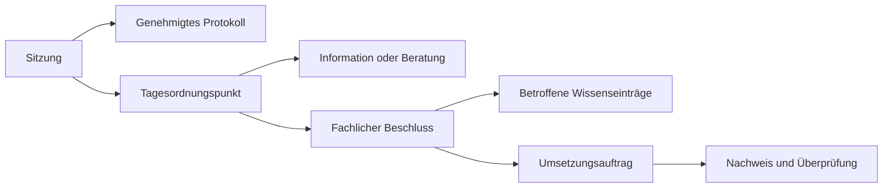

# Schulwissen als zentrale Wissensbasis einer Grundschule

Stand: 30.10.2026. Untersuchte Codebasis: `a3a5f11`. Perspektiven: Schulleitung und Lehrkraft einer Grundschule in NRW, Jahrgänge 1–4, Jahrgangs- und Fachteams sowie Zusammenarbeit mit dem Ganztag. Ausgangspunkt ist die GGS Niederkassel mit rund 24 Lehrkräften.

## 1. Ergebnis und Zielbild

Die App besitzt einen tragfähigen Kern für Arbeitspläne, Konzepte, Protokolle, nachvollziehbare Freigaben und deren Suche. Die größte Erweiterung ist eine **Alltagsebene des Schulwissens**: verständliche Abläufe, Zuständigkeiten, Formulare, Jahresfristen und kurze Antworten auf wiederkehrende Fragen. Dazu braucht es eine verlässliche Pflegeorganisation.

Für die Schulleitung muss die App beantworten: **Was ist verbindlich, wer verantwortet es, was muss überarbeitet werden und was ist noch umzusetzen?**

Für eine Lehrkraft muss sie beantworten: **Was gilt für mich, wie gehe ich jetzt vor, wen spreche ich an und wo liegt das passende Material?**

Das sinnvolle Ziel ist ein verbindliches schulisches Handbuch mit einem zentralen Einstieg zu Dateien und Fachsystemen. Nextcloud bleibt der Dateispeicher. Fallakten, Leistungsdaten und personenbezogene Verwaltungsverfahren behalten ihren vorgesehenen Ablageort. Eine einzige Such- und Einstiegsoberfläche erfordert keine Vervielfachung dieser Daten.

Die folgenden Inhaltsbereiche sind ein Produkt- und Organisationsvorschlag. Daraus folgt nicht, dass jede Schule für jeden genannten Bereich ein eigenes rechtlich vorgeschriebenes Konzeptdokument führen muss.

## 2. Vorgehen und belastbare Feststellungen

Die Analyse umfasst Datenmodell, Rechte, Dokumenttypen, Schreib- und Freigabewege, Suche, Exporte, Planung, Dateiextraktion und Betriebsdokumentation. Ergänzend wurden die lokale Anwendung mit den vorhandenen Demo-Rollen und ausschließlich lesende Datenbankabfragen geprüft. Es wurden keine schulischen Inhalte geändert oder genehmigt. Ein Einsatztest mit dem Kollegium ist dadurch nicht ersetzt.

### Bereits vorhanden

- Arbeitsplan Deutsch mit strukturierten Ritualen und Vorhaben, Kompetenzen, Leistungsfeldern und sieben Auswertungen.
- Generische Arbeitspläne für weitere Fächer, Konzepte aus Grundlagenkapiteln und Konferenzprotokolle aus Kopf und Tagesordnungspunkten.
- Suche über Inhalte, Kompetenzen, Beschlüsse und indexierte Dateien; tippfehlertolerante Vorschläge.
- Versionen, Vergleiche, Beschlussbezüge und Rückverweise.
- Gemeinsame Protokollgenehmigung mit Prüfung auf Vollständigkeit und zwischenzeitliche Änderungen.
- Geschütztes Löschen nicht verwendeter Entwürfe, dauerhafte Reservierung ihrer Kennungen.
- Persönliche Planung mit privaten Häkchen und Notizen, begrenzte Startseitenbereiche und vollständige Listen.
- Nextcloud-Verlinkung und Indexierung sowie OIDC technisch vorbereitet; lokale Anmeldung vorhanden.

### Lokale Stichprobe

| Prüfung | Befund |
| --- | --- |
| Fächer | Alle neun vereinbarten Fachdatensätze sind angelegt. |
| Kompetenzdaten | 117 Erwartungen für Deutsch; für die anderen acht Fächer waren in der geprüften Datenbank keine Kompetenzdatensätze vorhanden. Technische Fachunterstützung und vollständige fachliche Befüllung sind unterschiedliche Ausbaustände. |
| Fachliche Prüfliste Deutsch | 61 Datensätze sind als zu prüfende Stufenzuordnung markiert; bei 20 „u. a.“-Erwartungen ist die schulische Festlegung leer. Die vorhandene Prüfliste kann diese Arbeit bereits unterstützen. |
| Nextcloud / OIDC | Beide Konfigurationsprüfungen liefern in der lokalen Instanz `False`. Die Verbindungen sind dort nicht eingerichtet; eine andere Installation wurde nicht bewertet. OIDC bleibt optional, lokale Konten sind bereits nutzbar. |
| Dokument anlegen | Schulleitung: erreichbar. Lehrkraft: HTTP 403. |
| Dokument-PDF herunterladen | Schulleitung: erreichbar. Lehrkraft: HTTP 403. Browserdruck der Leseansicht bleibt möglich. |
| Beschlussvorlage | Schulleitung: erreichbar. Lehrkraft: HTTP 403; Redaktion hat den vorgesehenen Zugang. |
| Vertrauliche Dokumentbereiche | Kein eigenes Leserechtemodell pro Dokument oder Bereich vorhanden. |
| Gewöhnliches gemeinsames Bearbeiten | Keine erwartete Ausgangsversion im normalen Speicherweg geprüft. Versionshistorie vorhanden, Schutz vor unbemerktem Überschreiben durch einen zweiten Bearbeiter fehlt. Die neue Protokoll-Gesamtfreigabe besitzt dagegen eine signierte Standprüfung. |

### Konkreter Befund zur Rolle „Lesend“

Die beabsichtigte Regel lautet: freigegebene Fassungen lesen, keine Arbeitsstände. Die Leseansicht berücksichtigt diese Unterscheidung. Die Suche arbeitet dagegen mit einem gemeinsamen Suchtext aus aktuellem und gegebenenfalls freigegebenem Inhalt und gibt den aktuellen Eintragstitel und Status zurück.

In drei lesenden Suchabfragen wurden **zwei Treffer mit Arbeitsstand-Titel und Arbeitsstand-Status statt der freigegebenen Angaben** festgestellt. Das sind Trefferzählungen, keine Aussage über zwei verschiedene Dokumente. Es wurden dafür keine Inhalte verändert und hier keine Entwurfstexte wiedergegeben.

Rückverweise besitzen ebenfalls keinen nutzerbezogenen Filter im zugehörigen Abfragehelfer. In der lokalen Stichprobe wurden dort keine Verweise auf nicht lesbare Quellen gefunden; dies ist ein Codebefund und keine bestätigte Auslieferung solcher Quellen.

**Priorität: vor einem Ausbau um vertrauliche Bereiche beheben.** Alle Oberflächen brauchen dieselbe aufgelöste Lesefassung und dieselben Rechte: Treffer, Ausschnitte, Vorschläge, Anhänge, Metadaten, Rückverweise, Filter und Exporte.

## 3. Perspektive Schulleitung

| Alltagssituation | Was heute unterstützt wird | Was zur vollständigen Unterstützung fehlt |
| --- | --- | --- |
| Schuljahresbeginn vorbereiten | Dokumente, Arbeitsgruppen und Arbeitspläne sind vorhanden. | Schuljahresfahrplan mit Zuständigkeiten, Stellvertretungen, wiederkehrenden Vorbereitungen und Fristen; Jahreswechsel ohne Verlust alter Stände. |
| Konferenz vorbereiten und nachhalten | Protokolle, Beschlussvorlagen und gemeinsame Protokollgenehmigung. | Themen einreichen, Agenda ordnen, Sitzung organisieren, Entscheidungen von Informationen unterscheiden und daraus Aufgaben mit Termin ableiten. |
| Prüfen, ob Beschlüsse umgesetzt werden | Der Beschluss und seine freigegebenen Fassungen sind nachvollziehbar. | Umsetzungsverantwortung, Termin, Bearbeitungsstand, Nachweis und Wiedervorlage. Die private Unterrichtsplanung ist dafür kein gemeinsames Aufgabenregister. |
| Eine neue Vorgabe einarbeiten | Einträge überarbeiten und mit bestehenden Inhalten verlinken. | Übersicht betroffener Regelungen, zuständige Inhaltsverantwortliche, Änderungshinweise und getrennte aktuelle beziehungsweise künftig wirksame Fassungen. |
| Schulprogramm und Schulentwicklung steuern | Konzepte lassen sich als Textkapitel ablegen. | Entwicklungsziele, Maßnahmen, Meilensteine, Fortbildungsbezug, Überprüfung und ausreichend anonymisierte Ergebnisübersichten verknüpfen. |
| Aufgaben übergeben, neue Kolleginnen einarbeiten | Inhalte können gesucht und gelesen werden. | Funktionenkatalog, Übergabepakete, Einarbeitungswege und wiederkehrende Checklisten, die keine Kenntnis der bisherigen Dokumentnamen voraussetzen. |
| Mit Ganztag und weiteren Berufsgruppen zusammenarbeiten | Konten und die Rolle „Lesend“ sind vorhanden. | Gezielter Zugang zu relevanten Bereichen; gegebenenfalls redaktionelle Mitwirkung an gemeinsamen Abläufen ohne Zugriff auf alle anderen Arbeitsstände. |
| Ein Ausfall tritt ein | Betriebs- und Sicherungsanweisungen sind dokumentiert. | Nachgewiesene Wiederherstellung, benannte Betriebsvertretung, Überwachung fehlgeschlagener Indexierung und offline verfügbare besonders wichtige Anweisungen. |

Die Schulleitung braucht damit einen begrenzten Arbeitsbereich „Zu prüfen / zu entscheiden / umzusetzen“. Er sollte wenige handlungsrelevante Punkte anzeigen, etwa überfällige Inhaltsprüfungen oder offene Konferenzaufträge. Private Notizen und Häkchen der Lehrkräfte bleiben davon getrennt.

Der Referenzrahmen des Landes betrachtet neben Unterricht auch Schulkultur, Professionalisierung sowie Führung und Management. Daraus ergibt sich für diese Produktanalyse, dass die zentrale Wissensbasis über Facharbeitspläne hinausreichen sollte. [MSB NRW: Referenzrahmen Schulqualität](https://www.schulministerium.nrw/referenzrahmen-schulqualitaet)

## 4. Perspektive Lehrkraft

| Alltagssituation | Heutiger Weg | Fehlende Unterstützung |
| --- | --- | --- |
| „Was gilt bei uns zur Leistungsbewertung?“ | Suche und Leistungsfelder; Beschlussbezug ist sichtbar. | Verbindlicher Lesestand als Standard auch für bearbeitungsberechtigte Personen, passende Zielgruppe und kurzer Hinweis auf die letzte wesentliche Änderung. |
| „Ich plane einen Ausflug.“ | Ein Ablauf könnte in einem Konzeptkapitel beschrieben werden. | Ein wiederverwendbarer Ablauf mit Schritten, Zuständigen, schulischen Fristen und den gültigen Formularen. Ausgefüllte Unterlagen bleiben am vorgesehenen Ort. |
| „Ein Kind fehlt / Eltern bitten um Beurlaubung.“ | Generischer Suchbegriff kann einen passenden Text finden, falls jemand ihn angelegt hat. | Kurze Handlungsanweisung, zuständige Funktion, blanke Vorlage und Verweis auf das zuständige Verfahren. Kein personenbezogenes Fallbuch in Schulwissen. |
| „Ich vertrete morgen in einer anderen Klasse.“ | Arbeitspläne und Materialien sind erreichbar, wenn deren Titel bekannt sind. | Ein kuratiertes Vertretungspaket mit allgemeinen Klassen- und Raumabläufen, Materialorten und Ansprechpersonen; sensible Informationen über das dafür vorgesehene Verfahren. |
| „Zwei Personen bearbeiten den Jahrgangsplan.“ | Beide können im Arbeitsbereich schreiben; Fassungen bleiben erhalten. | Schutz vor unbemerktem Überschreiben, einfache Änderungsanfrage bei gültigen Einträgen und sichtbare Verantwortlichkeit im normalen Formular. |
| „Ich brauche ein Formular oder eine Vorlage.“ | Anhänge und Nextcloud-Verweise können geöffnet werden. | Formularverzeichnis mit Verwendungszweck, aktuellem Stand und direkten Bezügen zu den passenden Abläufen; freigegebene Dokument-PDFs ohne Umweg über die Schulleitung. |
| „Was hat sich seit meiner Abwesenheit geändert?“ | Änderungen sind je Dokument vergleichbar. | Eine persönliche, nach Relevanz gefilterte Übersicht wesentlicher Änderungen sowie abonnierbare Bereiche oder ein sparsamer Sammelhinweis. |
| „Ich fange neu an dieser Schule an.“ | Die globale Suche steht bereit. | Einstieg nach Aufgaben: erste Woche, Zugänge, Schlüssel, Kopieren, Material, Kommunikation, Ganztag, Ansprechpersonen und verbindliche Regeln. |
| „Ich plane mehrere Fächer für meine Klasse.“ | Persönlicher Fahrplan jeweils für einen Arbeitsplan. | Gespeicherter Kontext aus Schuljahr/Klasse, Überblick über mehrere Fächer und Unterstützung jahrgangsübergreifender Lerngruppen. |

Die Zuständigkeit ist am Eintrag bereits vorgesehen. In der gewöhnlichen Eingabemaske fehlt jedoch eine direkte Auswahl dafür; Zuordnungen erfolgen teils automatisch über Arbeitsgruppen oder über die Verwaltung. Für die Delegation von Schulwissen braucht es einen verständlichen Pflegeweg samt Stellvertretung und Übergabe.

Eine Lehrkraft sollte zwischen „verbindlich nachlesen“ und „gemeinsam erarbeiten“ wechseln können. Ihre Berechtigung, Entwürfe zu bearbeiten, muss nicht bedeuten, dass ihr beim schnellen Nachschlagen vorrangig ein Arbeitsstand präsentiert wird.

## 5. Informationslandkarte für eine normale Grundschule

„Als Text möglich“ bedeutet: Diese Information lässt sich bereits in einem Konzeptkapitel erfassen. Das ist noch keine gezielte Unterstützung des zugehörigen Schulablaufs.

| Informationsbereich | Typische Inhalte | Heute | Sinnvolle Abbildung |
| --- | --- | --- | --- |
| Schulprofil und Schulprogramm | Leitbild, pädagogische Grundsätze, Entwicklungsziele, Evaluation | Konzepte als Text möglich | Schulprogramm als strukturierte Sammlung mit verknüpften Zielen, Maßnahmen und Überprüfung |
| Unterricht in neun Fächern | Arbeitspläne, Progression, Leistung, Lehrmittel, Fachabsprachen | Deutsch vertieft; weitere Fächer technisch möglich | Je Fach kuratierte Inhalte und Lehrplanbezug; passende Felder statt einer unveränderten Deutschmaske für jedes Fach |
| Querschnittsthemen | Sprachbildung, DaZ, Inklusion, Medien, BNE, Demokratiebildung | Freitext und Verweise möglich | Themenkennzeichnung und Bezüge über mehrere Fächer und Konzepte hinweg |
| Förderung und Beratung | Allgemeine Förderwege, Zuständigkeiten, diagnostische Verfahren, Nachteilsausgleich als Verfahren | Als Text möglich | Abläufe und Vorlagen; personenbezogene Ergebnisse oder Entscheidungen im zuständigen Fachverfahren |
| Schuleingang und Übergänge | Kita-Kooperation, Einschulung, Schuleingangsphase, Übergang in die Sekundarstufe | Als Text möglich | Wiederkehrende Jahresabläufe, Checklisten und Kontakte, ohne individuelle Kindakten |
| Leistungsbewertung und Zeugnisse | Kriterien, Bewertungsabsprachen, allgemeine Zeugnisabläufe | Fachbezogene Leistungsfelder vorhanden | Verbindliche Gesamtsicht plus schuljahresbezogene Ablauf- und Formularbezüge; individuelle Noten bleiben im Fachsystem |
| Schulorganisation | Krankmeldung, Vertretung organisieren, Aufsicht, Abholregeln, Räume und Schlüssel | Als Text möglich | Kurze Ablaufkarten, Funktionsverzeichnis, Material- und Raumhinweise; aktuelle Pläne verlinken |
| Jahreslauf | Konferenzen, Elternabende, Zeugnisvorbereitung, Projektwochen, Feste, Sportveranstaltungen | Kein eigener Jahresplan | Wiederkehrende Ereignisse mit Vorbereitung, Zuständigen und relevanten Wissenseinträgen |
| Veranstaltungen und Fahrten | Ausflüge, Klassenfahrten, Theater, Bücherei, Radfahrausbildung | Als Text und Anhang möglich | Wiederverwendbare Checklisten, Genehmigungswege und blanke Formulare; Buchung und Fallunterlagen passend verorten |
| Zusammenarbeit mit Eltern | Gesprächsleitfäden, Informationsvorlagen, Beschwerdewege, Mitwirkung | Text und Protokolle möglich | Freigegebene Vorlagen und Verfahren, Quellenstand und gegebenenfalls Sprachvarianten; keine Gesprächsakten |
| Ganztag und weitere Professionen | Lernzeit, Übergaben als allgemeiner Ablauf, gemeinsame Regeln, Zuständigkeiten | Lesender Zugang vorhanden | Gemeinsamer, gezielt freigegebener Arbeitsbereich mit klarer Pflegeverantwortung |
| Sicherheit und Krisen | Allgemeine Alarm-, Unfall- und Meldewege, aktuelle Ansprechfunktionen | Nur generische Textablage | Gepflegte Kurzübersichten, berechtigungsgerechte Details und unabhängige Offline-Fassung; konkrete Falldokumentation getrennt |
| Prävention und Schutz | Schutzkonzept, Verhaltensregeln, Beschwerde- und Beratungswege | Als Konzept möglich | Verbindliche Regelungen mit Zuständigkeit, Überprüfung und Verweisen auf aktuelle Verfahren |
| Personalbezogenes Organisationswissen | Wer hat welche Funktion, Stellvertretung, allgemeine Einarbeitung und Fortbildungswissen | Nutzer und Arbeitsgruppen, Verantwortung je Eintrag | Funktionskatalog und Übergabewissen; keine Personalakten oder Gesundheitsangaben |
| IT und Medien | Dienstgeräte, Support, Kopierer, Lernplattformen, Störungsmeldung, zugelassene Werkzeuge | Als Text und Nextcloud-Datei möglich | IT-Abläufe, dienstliche Kontakte und Hilfeseiten; Zugangsdaten über geeignete Geheimnisverwaltung |
| Materialien und Ressourcen | Materialkisten, Lehrwerke, Geräte, Räume, Ausleihe und Nutzungshinweise | Dateien und Materialfelder vorhanden | Auffindbares Verzeichnis mit Standort, Bestellweg und Zuständigkeit; bei Bedarf Verweis auf Buchungs-/Ausleihsystem |
| Gremien und Konferenzen | Agenda, Protokoll, Fachentscheidung, Umsetzung | Grundstruktur und Freigaben vorhanden | Sitzung, einzelne Entscheidungen und Folgeaufträge miteinander verknüpfen |
| Qualitätsentwicklung und Fortbildung | Entwicklungsmaßnahmen, Fortbildungsplanung, Wissenstransfer, Evaluation | Konzepte und Anhänge möglich | Ziele, Maßnahmen, Rückmeldung und Wiedervorlage; Ergebnisse ausreichend anonymisieren |
| Rechts- und Vorgabenwissen | Amtliche Quellen, lokale Umsetzung, Zuständigkeit, letzte Prüfung | Links/Freitext möglich | Quellenverzeichnis mit Prüfstand und Auswirkungen auf betroffene Regelungen |
| Schulgeschichte und bewährte Praxis | Erprobte Projekte, Materialerfahrungen, übergabefähige Veranstaltungsabläufe | Als Text möglich | Wiederverwendbare Erfahrungssammlungen mit klarer Unterscheidung zwischen Empfehlung und verbindlicher Regel |

## 6. Zentrale fachliche Unterscheidungen

### Gültigkeit, Verbindlichkeit und Sichtbarkeit trennen

Aktuell tragen sehr unterschiedliche Inhalte dieselben Statuswerte. Für den Ausbau sollten vier Fragen unabhängig beantwortet werden:

1. **Was ist es?** Beispielsweise Konzept, Arbeitsanweisung, Ablauf, Formular, Material oder Erfahrungsbericht.
2. **Wie verbindlich ist es?** Beispielsweise Konferenzentscheidung, Weisung im zuständigen Verantwortungsbereich, externe Vorgabe oder freiwillige Empfehlung.
3. **Wer darf es lesen und bearbeiten?** Beispielsweise Kollegium, definierte Kooperationsgruppe oder Leitung; redaktionelle Zuständigkeit separat.
4. **Welcher Stand gilt wann?** Freigegeben am, wirksam ab, gegebenenfalls wirksam bis, ersetzt durch, zuletzt fachlich geprüft und nächster Prüftermin.

Ein Prüftermin ist keine automatische Außerkraftsetzung. Eine bereits beschlossene Änderung kann erst künftig wirksam werden. Ein Formular braucht einen gültigen aktuellen Stand, ohne dass jede Änderung einen neuen Konferenzvorgang rechtfertigt.

Schulprogrammfortschreibung und Qualitätsentwicklung haben im Schulgesetz einen eigenen Stellenwert. Auch die Aufgaben der verschiedenen Gremien sind unterschiedlich geregelt. Die App sollte Quelle und zuständige Freigabe sichtbar machen; ein Administrationskonto allein belegt die fachliche Zuständigkeit eines Gremiums nicht. [SchulG NRW, insbesondere §§ 3, 59, 65, 68 und 70](https://bass.schule.nrw/6043.htm)

### Protokollgenehmigung und fachlichen Beschluss unterscheiden

Die neue Gesamtgenehmigung setzt alle aktiven Protokollblöcke auf „beschlossen“. Für das bisherige Veröffentlichungsmodell ist das nutzbar. Als allgemeine Wissensbasis muss zusätzlich erkennbar sein, ob ein TOP eine Information, eine Beratung, eine vertagte Frage oder eine konkrete Entscheidung dokumentiert.

Die Genehmigung einer Niederschrift und die in ihr dokumentierten fachlichen Entscheidungen sind getrennte Gegenstände. Eine genehmigte Mitteilung soll beim Nachschlagen nicht wie eine neu beschlossene Schulregel erscheinen.

Empfohlene Beziehungen:

Abstimmungsvermerke, gegebenenfalls Entscheidungsergebnis, Zuständigkeit und Folgeauftrag sollten strukturiert erfasst werden können. Ein Beschlusstext innerhalb eines TOP ist heute zunächst Text und erzeugt nicht automatisch einen solchen verknüpften Datensatz.

### Eine Quelle für verbindliches Wissen festlegen

Zu einem Thema sollte es einen maßgeblichen aktuellen Eintrag geben. Ein Protokoll dokumentiert seine Entstehung, eine Vorlage unterstützt seine Anwendung, und eine Checkliste unterstützt die Umsetzung. Diese Objekte sollten verlinkt sein, damit sich Regeln nicht gleichzeitig in drei voneinander abweichenden Texten entwickeln.

## 7. Empfohlene Bausteine

Die bestehende Registry ist ein geeigneter Ausgangspunkt. Der nächste Ausbau sollte kleine fachliche Typen ergänzen, die dieselben Lesebausteine, Rechte, Suche und Versionen verwenden.

| Baustein | Wesentliche Angaben |
| --- | --- |
| Ablauf | Anlass, Kurzantwort, Zielgruppe, Voraussetzungen, Schritte, zuständige Funktion, Fristen, Formulare, Quellen, Pflegeverantwortung |
| Funktion und Kontakt | Aufgabe, besetzende Person oder Stelle, dienstlicher Kontakt, Stellvertretung, Gültigkeitszeitraum, zugehörige Abläufe |
| Formular und Vorlage | Verwendungszweck, gültige Dateifassung, zuständiger Ablauf, Quelle, Stand, Pflegeverantwortung |
| Regel oder Absprache | Klartext, Geltungsbereich, Verbindlichkeit, Quelle/Freigabe, Wirksamkeit und ersetzte Regel |
| Termin oder Jahresereignis | Schuljahr, Datum/Zeitraum oder Wiederholung, Vorbereitung, Zuständigkeit und Wissensbezüge |
| Auftrag | Herkunft, Zuständigkeit, Termin, Zustand, Ergebnis und Verweis auf den zugehörigen Beschluss |
| Entwicklungsziel | Ziel, Maßnahme, Verantwortung, Meilensteine, Überprüfung und Ergebnis |
| Einarbeitungspaket | Zielgruppe, wenige relevante Regeln, Aufgaben, Kontakte, Zugänge als Verweise und Materialien |
| Materialsammlung oder FAQ | Auffindbare Kurzbeschreibung, Fach/Jahrgang/Thema, Standort/Dateien, Nutzungshinweise, Pflegeverantwortung |

Nicht jeder Baustein benötigt sofort eine neue Datenbanktabelle. Wiederholungen, Aufgaben und Zugriffsrechte brauchen jedoch belastbare Struktur; sie sollten nicht nur in Fließtext versteckt werden.

### Beispiel: „Einen Ausflug planen“

Ein Einstieg liefert die schulisch gültige Kurzantwort. Darunter stehen die Schritte vor Planung, vor Durchführung und zur Nachbereitung, die jeweils zuständige Funktion sowie die aktuellen blanken Formulare. Das Handbuch verlinkt die maßgeblichen Quellen und den Ablageort ausgefüllter Unterlagen. Ein Jahresereignis oder Auftrag kann diesen Ablauf wiederverwenden. Namen teilnehmender Kinder werden dadurch nicht in den Wissenseintrag übernommen.

### Beispiel: „Die Leseförderung neu abstimmen“

Die Lehrkraft öffnet die aktuell geltende Absprache. Eine Änderungsanfrage führt zum zuständigen Fachteam. Das Team erarbeitet einen geschützten Arbeitsstand ohne gegenseitiges Überschreiben. Ein konkreter Konferenzbeschluss verknüpft die neue Regel mit dem Wirksamkeitsdatum. Betroffene Kolleginnen und Kollegen erhalten einen gebündelten Änderungshinweis. Bestehende Jahresplanungen zeigen, ob eine Anpassung relevant ist.

### Suchsprache des Kollegiums berücksichtigen

Gemeinsame Schlagwörter und gepflegte Synonyme helfen, denselben Ablauf unter den tatsächlich benutzten Begriffen zu finden, etwa „Beurlaubung“, „Freistellung“ oder „Fehlzeiten“. Die vorhandene Wortstamm- und Tippfehlersuche bildet solche fachlichen Beziehungen nicht automatisch ab. Kurzantworten und FAQ-Einstiege sollten auf denselben maßgeblichen Eintrag zeigen.

## 8. Technische und organisatorische Prioritäten

| Priorität | Änderung | Warum zuerst / Abnahmekriterium |
| --- | --- | --- |
| P0 | Lesefassungen über Suche, Vorschläge, Metadaten und Verweise vereinheitlichen | Ein lesendes Konto findet ausschließlich zulässige Titel, Inhalte und Stände; Tests berücksichtigen Treffertexte und nicht nur Eintragsnummern. |
| P0 | Zugriff pro Dokument/Bereich und redaktionelle Zuständigkeit abbilden | Die globale Redaktion darf derzeit alle Einträge bearbeiten. Vertrauliche oder gezielt kooperative Bereiche brauchen eigene Regeln einschließlich Suche und Anhängen. |
| P0 | Gewöhnliche Bearbeitung gegen Versionskonflikte absichern | Zwei gleichzeitig geöffnete Formulare dürfen sich nicht unbemerkt überschreiben. Versionierung allein verhindert das nicht. |
| P0 | Gültigen Lesestand und passende Freigabewege modellieren | Beim Nachschlagen müssen aktuelle, künftige und ersetzte Regelungen unterscheidbar sein. Routineinformationen benötigen eine angemessene redaktionelle Freigabe. |
| P0 | Freigegebene Dateibezüge absichern | Ein unveränderlicher Text-Schnappschuss fixiert die später veränderte Nextcloud-Datei noch nicht. Normative Anhänge brauchen eine feste Fassung/Prüfsumme oder einen klaren Änderungs- und Prüfhinweis. Dynamische Materialsammlungen dürfen anders behandelt werden. |
| P0 | Betrieb und Dateizugänge nachweisbar einrichten | In der lokalen Instanz sind Nextcloud und OIDC nicht konfiguriert. Sicherungsverfahren sind beschrieben; tatsächliche automatische Sicherung und Wiederherstellung wurden in dieser Analyse nicht nachgewiesen. |
| P1 | Schulhandbuch mit Abläufen, Funktionen und Formularen | Beispielsweise Ausflug, Abwesenheit, Elternanliegen und IT-Störung ohne Nachfrage bei der Schulleitung bearbeiten können. |
| P1 | Wissenspflege einführen | Jede maßgebliche Information hat eine fachliche Verantwortung, Prüfstand und Wiedervorlage; Hinweise auf Fehler gehen an diese Funktion. |
| P1 | Jahresplan und Konferenzaufträge ergänzen | Beschlüsse führen zu benannten Folgeaufgaben; wiederkehrende schulische Arbeit wird rechtzeitig vorbereitet. |
| P1 | Schuljahres-, Klassen- und Fachkontext verbessern | Mehrere Fächer und jahrgangsübergreifende Lerngruppen passend anzeigen; inhaltliche Befüllung der acht weiteren Fächer organisieren. |
| P1 | Veröffentlichungs- und Exportrechte für den Alltag abstimmen | Lehrkräfte können erlaubte gültige Dokumente als PDF nutzen; vollständige Arbeitsstände und Verwaltungsdaten bleiben gesondert geschützt. |
| P1 | Bedeutende Änderungen und Einarbeitung zugänglich machen | Relevante Änderungen gebündelt anbieten; neue Kolleginnen finden ihre ersten Aufgaben ohne Kenntnis der Dokumentstruktur. |
| P2 | Bestandswissen systematisch übernehmen | Ordnerinhalte sichten, maßgebliche Quellen auswählen, Dubletten bereinigen und Scans bei Bedarf per OCR erschließen. Aktuell werden verlinkte Dateien indexiert, keine beliebigen Nextcloud-Ordner vollständig übernommen. |
| P2 | Schulentwicklung und Erfahrungstransfer vertiefen | Ziele, Evaluation und Fortbildungswissen verknüpfen; vorhandene Maßnahmen transparent auswerten. |

P0 bezeichnet hier Voraussetzungen für die belastbare Nutzung als alleinige schulische Wissensbasis. Nicht jeder Punkt ist eine akute Störung des bisherigen Arbeitsplan-Einsatzes. Die belegte Such-Inkonsistenz und der fehlende Konfliktschutz verdienen unabhängig vom weiteren Ausbau Aufmerksamkeit.

**Empfohlene Ausbaureihenfolge:** zuerst die P0-Grundlagen, dann ein kleines, gut gepflegtes Schulhandbuch, anschließend Jahreslauf und Beschlussumsetzung, danach Fachbreite und Schulentwicklung. Neue Bereiche sollten mit echten Informationsbeständen und den zuständigen Personen befüllt werden, statt zunächst viele leere Menüpunkte anzulegen.

### Kleiner, vollständig gepflegter Einstieg

Nach den Grundlagen würde ich zunächst zehn häufige Handlungen abdecken: eigene Abwesenheit melden, Vertretung übernehmen, Ausflug planen, einen Beurlaubungsantrag einordnen, den schulischen Unfallmeldeweg finden, eine IT-Störung melden, Material bestellen, die gültige Leistungsabsprache nachlesen, einen Übergang vorbereiten und ein Konferenzthema einbringen. Die Auswahl ist mit dem Kollegium an die tatsächliche Schule anzupassen.

Jeder dieser Einstiege braucht eine verantwortliche Funktion und Vertretung, eine kurze Antwort, die geltenden Schritte und Fristen, aktuelle Vorlagen, Quellen und einen dokumentierten Prüfstand. Erst dann folgen weitere Bereiche. Die inhaltliche Befüllung und dauerhafte Pflege sind ebenso wichtig wie neue Funktionen.

## 9. Grenzen einer alleinigen Wissensbasis

Die bestehende SPEC schließt Schüler- und Elterndaten bewusst aus. Diese Grenze bleibt für das vorgeschlagene Schulhandbuch sinnvoll. Es speichert beispielsweise den Ablauf zur Förderung, eine blanke Gesprächsvorlage und die zuständige Funktion. Individuelle Förderpläne, Beratungsnotizen, Noten, Gesundheitsangaben und ausgefüllte Falldokumente erhalten darüber einen Wegweiser zu ihrem zuständigen System.

Für personenbezogene Daten betont das Land die Aufgabenbindung und den erforderlichen Umfang; Zugänge zu Schüler- und Elterndaten sind zudem auf Personen mit entsprechendem Aufgabenbedarf beschränkt. Dokumentrechte allein machen eine Wissensbasis daher noch nicht zu einem geeigneten Fallaktenverfahren. [MSB NRW: Datenschutz im Schulbereich](https://www.schulministerium.nrw/schule-bildung/recht/datenschutz-im-schulbereich), [SchulG NRW § 120](https://bass.schule.nrw/6043.htm#1-1p120)

Dasselbe gilt für Personalakten und vertrauliche Einzelvorgänge. Funktionswissen und allgemeine Verfahren gehören in das Handbuch; die Vorgangsdaten bleiben entsprechend getrennt. Die Nextcloud-Indexierung benötigt dabei besondere Sorgfalt: Das technische Konto und Schulwissen verwenden derzeit nicht automatisch dieselben individuellen Dateirechte. Vertrauliche Ordner dürfen deshalb nicht allein durch einen Link im allgemeinen Bereich für dessen Suche erschlossen werden.

Weitere Systeme behalten dort ihre Aufgabe, wo sie veränderliche Transaktionen abbilden: beispielsweise aktuelle Stunden-/Vertretungsplanung, Buchungen oder Schülerverwaltung. Schulwissen sollte verlässlich zu ihnen führen und verbindliche Verfahren beschreiben. Für einen Netzausfall braucht besonders wichtiges Handlungswissen zusätzlich eine eigenständig erreichbare Fassung.

## 10. Abnahme im Schulalltag

Mit Schulleitung, zwei Lehrkräften unterschiedlicher digitaler Erfahrung sowie einer Person aus dem Ganztag erproben:

1. Eine neue Lehrkraft findet den gültigen Ablauf einer Abwesenheitsmeldung samt zuständiger Funktion.
2. Eine Lehrkraft findet die freigegebene Vorlage und die schulischen Schritte für einen Ausflug.
3. Eine Lehrkraft erkennt beim Nachschlagen eindeutig den geltenden Stand einer Leistungsabsprache; einen Entwurf verwechselt sie nicht damit.
4. Ein Fachteam bearbeitet parallel; eine widersprüchliche Speicherung erhält eine verständliche Auflösung statt eines stillen Überschreibens.
5. Die Schulleitung findet aus einem Beschluss den Folgeauftrag und seinen Bearbeitungsstand.
6. Bei einem Wechsel der Zuständigkeit wird die Pflegeverantwortung ohne Kopieren der Inhalte übergeben.
7. Eine OGS-Kraft findet passende freigegebene Absprachen und keine unzulässigen Treffer oder Anhänge.
8. Ein wesentlich geändertes Formular wird über den Ablauf, die Suche und die Materialübersicht in derselben aktuellen Fassung gefunden.
9. Ein überfälliger Prüftermin wird bei den zuständigen Personen sichtbar, ohne die Regel irrtümlich automatisch außer Kraft zu setzen.
10. Bei nicht erreichbarem WLAN ist das vorgesehene wichtige Handlungswissen dennoch verfügbar.

Die Zeit bis zur Antwort, falsche Abzweigungen, notwendige Rückfragen und Pflegeaufwand sollten beobachtet werden. Das Ergebnis entscheidet, ob die Wissensbasis tatsächlich den Schulalltag erleichtert.

## 11. Nachweise zum aktuellen Code

| Feststellung | Quellcode / vorhandene Dokumentation |
| --- | --- |
| Globale Entwurfssichtbarkeit, globale Redaktion, Schreibrechte | [kern/rechte.py](../kern/rechte.py) |
| Sichtbare Lesefassung und ungefilterter Rückverweishelfer | [kern/views.py](../kern/views.py) |
| Gemeinsamer Suchtext und aktuelle Trefferfelder | [suche/dienste.py](../suche/dienste.py), [eintragstypen/dienste.py](../eintragstypen/dienste.py) |
| Verfügbare fachliche Typen | [kern/dokumenttypen.py](../kern/dokumenttypen.py), [deutsch/eintragstypen.py](../deutsch/eintragstypen.py) |
| Datums- und Verantwortungsmodell, Versionen und Anhänge | [kern/models.py](../kern/models.py) |
| Persönliche Planung nach einem Arbeitsplan | [kern/planung.py](../kern/planung.py) |
| Dokumentanlage und Dokumentexport nur Administration | [kern/dokument_views.py](../kern/dokument_views.py), [kern/export_views.py](../kern/export_views.py) |
| Protokoll-Gesamtgenehmigung mit Standprüfung | [kern/arbeitsablauf.py](../kern/arbeitsablauf.py), [Protokoll-Workflow](protokoll-workflow.md) |
| Keine Texterkennung für gescannte PDFs | [kern/extraktion.py](../kern/extraktion.py) |
| Nextcloud-Rechte, Indexierungsumfang und Fachausbau | [PHASE4.md](../PHASE4.md) |
| Beschriebene Sicherung und Betriebsverfahren | [DEPLOYMENT.md](../DEPLOYMENT.md) |

Diese Analyse ändert keine Rechte oder Funktionen. Sie liefert die Grundlage für eine bewusste fachliche Erweiterung der bisherigen SPEC.
