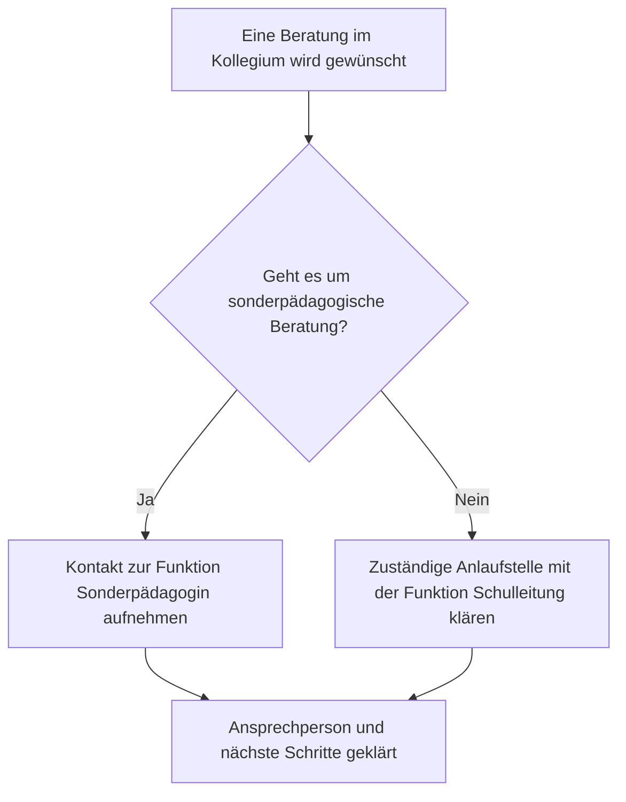

# Prozesswerkzeug: Abläufe erklären und Zuständigkeiten auflösen

Stand: 31.10.2026. Zugehörige Roadmap: [AP04–AP08](../ROADMAP.md). Diese Datei konkretisiert den ausdrücklichen Nutzerwunsch. Das Funktionsmodell aus AP04 ist umgesetzt; Prozessdaten, Editor, Grafik und Veröffentlichung aus AP05–AP08 sind weiterhin geplant.

## 1. Nutzerziel

Die Schulleitung oder eine berechtigte Redaktion definiert allgemeine schulische Abläufe. Kolleginnen finden diese als verständliche „Was passiert, wenn …?“-Grafik und können sich bei Bedarf Schritt für Schritt hindurchführen lassen.

Ein Schritt benennt beispielsweise die Funktion **Sonderpädagogin**. Die tatsächliche Besetzung kommt aus dem vorhandenen Nutzerstamm und wird im Backend gepflegt. Eine Umbesetzung erfordert keine Änderung sämtlicher Diagramme.

Drei Ansichten verwenden dieselbe fachliche Datenquelle:

1. **Definieren:** Schritte, Fragen, Verbindungen und Zuständigkeiten bearbeiten.
2. **Überblick:** automatisch erzeugte Grafik mit auswählbaren Schritten.
3. **Geführt nachlesen:** eine Frage beantworten und den passenden nächsten Schritt sehen.

Ein lesbarer linearer Text und eine Druckfassung gehören zum ersten vollständigen Lieferstand. Drag-and-drop ist für das Definieren nicht vorausgesetzt.

## 2. Schulfunktionsrollen und Nutzer

### Begriffe getrennt halten

| Begriff | Beispiel | Wirkung |
| --- | --- | --- |
| Berechtigungsrolle | Lehrkraft, Redaktion, Administration, Lesend | Regelt Zugriff und Bearbeitung |
| Arbeitsgruppe | Jahrgang 1/2, Fachteam Deutsch | Ordnet Zusammenarbeit und gegebenenfalls redaktionelle Bereiche |
| Schulfunktionsrolle | Sonderpädagogin, Schulleitung, IT-Ansprechperson | Benennt eine fachliche Zuständigkeit im Ablauf |
| Funktionsbesetzung | Vorhandenes Nutzerkonto übernimmt die Funktion in einem Zeitraum | Liefert die aktuelle Ansprechperson, keine zusätzlichen Berechtigungen |

Eine Schulfunktionsrolle wird als eigener fachlicher Datensatz geführt. Sie wird nicht als weitere technische Django-Gruppe mit stillschweigenden Sonderrechten eingeführt.

### Umgesetztes Funktionsmodell (AP04)

Einrichtung, genaue Auflösungsregeln und Schnittstelle: [AP04_SCHULFUNKTIONEN.md](AP04_SCHULFUNKTIONEN.md).

**Schulfunktion**

- Stabile Kennung, angezeigter Name, kurze Aufgabenbeschreibung.
- Aktiv/archiviert; referenzierte Funktionen nicht ersatzlos löschen.
- Besetzungsmodus: Einzelzuständigkeit oder bewusst ausgewiesenes Team.

**Funktionsbesetzung**

- Verweis auf die Schulfunktion und auf das vorhandene `Nutzer`-Modell.
- Hauptzuständigkeit oder Vertretung.
- Gültig ab, optional gültig bis; einheitlich definierte Datumsgrenzen.
- Optionaler klar bezeichneter Geltungsbereich, beispielsweise Jahrgänge 1/2. Dieser Bereich beschreibt die Zuständigkeit und vergibt keine Leserechte.
- Bei Bedarf eine dienstliche Erreichbarkeit oder ein Funktionskontakt; keine privaten Kontaktdaten verlangen.
- Änderungen nachvollziehbar erhalten, anstatt die bisherige Besetzung zu überschreiben.

Die Backend-Auswahl sucht vorhandene aktive Konten nach Anzeigename, Kürzel oder schulischer E-Mail. Keine zweite Personenkartei anlegen. Eine Person kann mehrere Funktionen übernehmen. Für externe Funktionen ohne Konto bleibt zunächst eine unbesetzte Funktion beziehungsweise ein gesonderter dienstlicher Funktionskontakt möglich; keine künstlichen Lehrkraftkonten erzeugen.

### Auflösung in der Leseansicht

Der Resolver erhält Funktion, gegebenenfalls Geltungsbereich und einen Zeitpunkt:

- Eine passende aktive Hauptbesetzung: Funktion und Person anzeigen.
- Passende Vertretung: als Vertretung ausweisen; eine vorübergehende Vertretung bewusst aktivieren, keine Abwesenheits- oder Gesundheitsdaten auswerten.
- Team: mehrere Zuständige als Team mit gegebenenfalls Aufgabenteilung anzeigen.
- Mehrere unvereinbare Einzelbesetzungen: bei der Pflege zurückweisen; konkurrierende Änderungen ebenfalls absichern.
- Keine erreichbare Besetzung: „Derzeit nicht besetzt“ beziehungsweise „Besetzung bitte prüfen“. Eine bewusst gepflegte Anlaufstelle anbieten; keine zufällige Person als Ersatz bestimmen.
- Deaktiviertes oder außerhalb des Zeitraums liegendes Konto: nicht als aktuelle Kontaktperson präsentieren. Historische Daten dadurch nicht stillschweigend verändern.

Zeitliche Überschneidungen und das Verhältnis Hauptzuständigkeit/Vertretung serverseitig und bei konkurrierender Pflege prüfen. Für eine Einzelzuständigkeit im selben Geltungsbereich darf es nicht unbeabsichtigt zwei gleichzeitige Hauptbesetzungen geben. Ein Team ist ausdrücklich möglich.

## 3. Prozess und gespeicherte Fassungen

Ein Prozess nutzt die bestehende Einheit **Dokument → Eintrag → Eintragsversion**. Vorgesehen sind ein Schulhandbuch-Dokumenttyp und ein Eintragstyp `prozess`, beispielsweise mit Kennungen `PR-01`. Die genaue Migration ergänzt die vorhandene Registry und die Dokumentanlage.

Geplante Angaben:

- Titel, Anlass/Kurzantwort, Zielgruppe, Schlagwörter und gegebenenfalls Synonyme.
- Inhaltliche Pflegefunktion und fachlicher Freigabeweg.
- Graph in einem versionierten, serverseitig validierten Datenformat mit eigener `schema_version`.
- Knoten, Verbindungen, Schulfunktionsreferenzen und Verweise auf zugängliche Wissenseinträge beziehungsweise Ressourcen.
- Gültiger Lesestand, Arbeitsstand und Angaben zum fachlichen Prüfstand.

Die Graphstruktur muss mit der bestehenden Formular-, Import- und Darstellungsvalidierung verbunden werden. Eine spezialisierte Eingabekomponente beziehungsweise ein strukturierter Feldtyp ist dafür vorgesehen. JSON als unkontrollierter Freitext erfüllt das Ziel nicht.

### Stabile Funktionen, aktuelle Personen

Die freigegebene Prozessfassung fixiert Schritte, Fragen, Verbindungen und referenzierte Funktionen. **Personennamen werden nicht in jeden Knoten hineinkopiert.** Die Kontaktanzeige löst die Besetzung dynamisch auf und ist ausdrücklich als aktuelle Zuständigkeit erkennbar.

So bleibt der Prozess unverändert, wenn eine neue Kollegin die Funktion übernimmt. Im historischen Kontext müssen „damals freigegebener Ablauf“ und „heute ansprechbare Person“ unterscheidbar sein. Eine spätere historische Kontaktansicht muss ausdrücklich als historisch gekennzeichnet sein und Korrekturstände sowie damalige Kontoaktivität berücksichtigen. AP04 bietet dafür gespeicherte Verwaltungsstände; sein aktueller Resolver rekonstruiert keine vergangenen Kontoaktivitäten.

Eine Änderung der Funktion selbst darf ihre Bedeutung nicht unbemerkt ersetzen. Referenzen und gegebenenfalls die damalige Funktionsbezeichnung müssen nachvollziehbar bleiben. Änderungen der Prozesslogik erzeugen wie bisher einen neuen Arbeitsstand.

## 4. Knoten und Verbindungen

| Knotenart | Inhalt | Verbindungen bei Veröffentlichung |
| --- | --- | --- |
| Start | Anlass des Ablaufs | Genau ein Start, kein Eingang, ein Ausgang |
| Handlung | Was ist zu tun? Welche Funktion ist zuständig? Welche Vorlage hilft? | Ein Folgeschritt |
| Entscheidung | Verständliche Frage | Mindestens zwei eindeutig beschriftete Alternativen, standardmäßig Ja/Nein |
| Ende | Ergebnis beziehungsweise nächster externer Anlaufpunkt | Kein Ausgang |

Knoten besitzen stabile interne IDs. Umordnen oder Umbenennen erzeugt keine neuen IDs. Verbindungen nennen Quell- und Ziel-ID; Entscheidungen enthalten verständliche Zweigbeschriftungen. Bedingungen sind erklärender Text und auswählbare Antworten, kein ausführbarer Programmcode.

Explizite Rücksprünge sind vorgesehen, etwa „erneut prüfen“. Von jedem erreichbaren Knoten muss ein Ende erreichbar sein. Kreise ohne Ausgang verhindern eine Freigabe. Rücksprünge müssen in Grafik und geführter Ansicht verständlich sein; sie dürfen keine endlose automatische Ausführung oder Darstellung auslösen.

### Validierung

Immer prüfen:

- Datenformat, Größen-/Längengrenzen und Schema-Version.
- Eindeutige Knoten- und Verbindungskennungen, gültige Verweisziele und zulässige Inhalte.
- Berechtigungen der verbundenen Ressourcen und zulässige Links.

Für die Veröffentlichung zusätzlich prüfen:

- Genau ein Start und mindestens ein Ende.
- Alle relevanten Knoten erreichbar, keine unbeabsichtigten losen Schritte oder fehlenden Ziele.
- Für jede Entscheidung klare, unterscheidbare und vollständig verbundene Alternativen.
- Keine ausgangslosen Kreise; explizite Kennzeichnung von Rücksprüngen.
- Zuständige Funktionen für fachlich erforderliche Handlungsschritte.
- Bewusster Umgang mit unbesetzten Funktionen und Vertretungen.

Eine unvollständige Zeichnung bleibt als Entwurf speicherbar, soweit sie strukturell sicher lesbar ist. Fehler werden am betreffenden Schritt erklärt und sind aus einer Übersicht anspringbar. Ein defekter Entwurf ersetzt keine bisher gültige Fassung.

## 5. Definieren im Editor

Vorgesehener Ablauf:

1. Prozess anlegen, Titel und Anlass eingeben.
2. „Schritt hinzufügen“ wählen: Handlung, Entscheidung oder Ende.
3. Text bearbeiten und eine bestehende Schulfunktionsrolle auswählen. Aktuelle Besetzung als Vorschau anzeigen.
4. Über „Danach weiter mit …“ beziehungsweise die Antwortzweige die Folgeschritte auswählen oder neu anlegen.
5. Die Grafik wird automatisch angeordnet und aktualisiert.
6. „Prüfen“ zeigt fehlende Angaben; „Als Entwurf speichern“ bewahrt den Stand.
7. Berechtigter Freigabeweg veröffentlicht den fachlich geprüften Ablauf.

Auswahl eines Knotens in der Vorschau öffnet dieselben bearbeitbaren Felder. Großzügige Ziele, Tastatur und Touch werden unterstützt. Drag-and-drop kann später ergänzen, ist aber keine Voraussetzung. Der Nutzer muss weder Mermaid noch BPMN noch JSON schreiben.

Freie Layoutpositionen und beliebige Formen sind für den ersten Stand nicht erforderlich. Die Darstellung darf keine zweite, unabhängig gepflegte Kopie der Prozesslogik werden.

## 6. Nachschlagen und „Was passiert, wenn …?“

- Überblick mit Start, Entscheidungen, Handlungen und Enden; auswählbare Knoten zeigen vollständige Erklärung und aktuelle Zuständigkeit.
- Geführte Ansicht mit jeweils aktueller Frage, auswählbaren Alternativen und passendem Handlungsschritt.
- Zurückgehen, Antwort ändern und neu beginnen sind möglich.
- Auf kleinen Bildschirmen ist die Schrittansicht ohne schwieriges Verschieben eines großen Diagramms vollständig nutzbar. Eine Übersicht mit geeignetem Zoom kann ergänzen.
- Antworten bleiben im Browser-Arbeitsspeicher und werden beim Neustart verworfen. Sie werden im ersten Stand weder im Benutzerprofil noch als Fallverlauf, URL-Parameter oder Schulungsnachweis gespeichert.
- Keine Eingabefelder für Kindernamen, Diagnosen, Gesprächsnotizen oder reale Fallakten ergänzen.

Die App erklärt einen allgemeinen Ablauf. Sie trifft keine automatisierte fachliche Entscheidung über einen konkreten Menschen und löst keine externe Maßnahme aus.

### Beispiel zur Darstellung

Das folgende Beispiel ist ausschließlich eine Demonstration der Bedienung, kein fachlich freigegebenes schulisches Verfahren. Die Personen stammen bei einer späteren echten Besetzung aus dem Nutzerstamm.

Beim Antippen von C erscheint beispielsweise: **Sonderpädagogin – aktuell besetzt mit [ausgewähltem Nutzerkonto]**, darunter eine gegebenenfalls gepflegte Vertretung und dienstliche Kontaktmöglichkeit. Diese Person steht nicht als unveränderlicher Text in der Grafik.

## 7. Rechte, Freigabe und Auffindbarkeit

- Alle Lehrkräfte erhalten Zugang zu den fürs Kollegium freigegebenen Prozessen. Bestehende Zugangsgrenzen anderer Bereiche gelten weiter.
- Autorenrechte richten sich nach dokument-/bereichsbezogener Redaktion und bestehendem Arbeitsbereich; sie folgen nicht automatisch aus einer Funktionsbesetzung.
- Besetzungen verwalten zunächst berechtigte Administrationskonten im Backend.
- Ein Fachverantwortlicher kann einen Prozess prüfen, ohne dadurch automatisch technische Administrationsrechte zu erhalten.
- Veröffentlichung, Wirksamkeit und Änderungsanfragen verwenden die gemeinsamen Wissensbausteine. Eine veränderte grafische Verzweigung ist eine inhaltliche Änderung.
- Suche und Vorschläge erschließen Titel, Anlass, Schlagwörter, Schritttitel und Funktionen jeweils aus der zulässigen Fassung. Bei Personensuche aktuelle Besetzungen berücksichtigen, ohne durch unberechtigte Prozesse oder veraltete Indexeinträge Informationen preiszugeben.
- Verwendete Wissenseinträge und Ressourcen dürfen keine Rechte durch einen Link oder eine eingebettete Vorschau erweitern.

## 8. Technische Leitplanken

- Django, Registry, vorhandene Schreibdienste, HTMX und Alpine weiterverwenden; die konkreten Erweiterungen mit dem dann aktuellen Code abgleichen.
- Eigene fachliche Modelle für Funktion und Besetzung, Verweis auf `settings.AUTH_USER_MODEL`; keine zweite Personenverwaltung.
- Prozessstruktur als validierter Schnappschuss des Eintrags. Funktionsreferenzen zusätzlich in die gemeinsame Referenzverwaltung integrieren, damit Verwendung und Schutz beim Archivieren auffindbar sind.
- Diagramm und Alternativdarstellungen aus derselben normalisierten Struktur erzeugen. Eine lokal eingebundene SVG-Darstellung ist ein geeigneter Ausgangspunkt.
- Falls eine Layoutbibliothek erforderlich ist, in AP06 einen kleinen technischen Vergleich mit Verzweigung und Rücksprung durchführen: lokale Einbindung, Lizenz, Wartbarkeit, Barrierefreiheit, Druck und keine neue Frontend-Plattform. Auswahl und verwendete Version dokumentieren.
- Keine externen Diagrammdienste mit Schulwissen beliefern. Anzeige- und Kontaktdaten serverseitig nach Rechten auflösen; keine Schulfunktionsänderung verändert unbemerkt Kontorechte.
- Autoreneingaben und Graphlabels sicher rendern. Ein Diagramm darf keinen unkontrollierten HTML-/Skriptausführungspfad eröffnen.
- Parallelpflege von Prozess und Besetzung sowie atomare Freigaben testen. Datenmigrationen und Exporte müssen die referenzierten Funktionen und unveränderlichen Kennungen berücksichtigen.

## 9. Tests und Pilot

Mindestens prüfen:

1. Funktion aus vorhandenem aktiven Konto besetzen; dieselbe Person in mehreren Funktionen.
2. Wechsel, Vertretung, Team, abgelaufene Zuordnung und unbesetzte Funktion korrekt anzeigen.
3. Keine Berechtigungserweiterung durch eine Besetzung; konkurrierende Einzelbesetzungen verhindern.
4. Prozess mit Ja/Nein und mehr als zwei Alternativen erstellen, speichern, laden und ändern.
5. Fehlendes Verbindungsziel, unerreichbarer Knoten, doppelte ID und Kreis ohne Ausgang verständlich zurückweisen.
6. Rücksprung mit Ausgang sicher darstellen und geführt nutzen.
7. Gleichzeitige Bearbeitung ohne unbemerktes Überschreiben; alte freigegebene Fassung bleibt erhalten.
8. Personenwechsel aktualisiert aktuelle Kontakte, ohne eine neue Prozessfassung zu erzeugen.
9. Rechte für Lesestand, Entwurf, Suchtreffer, Verweise, Ressourcen und Exporte durchgängig beachten.
10. Tastatur, 390/768/1024/1440 Pixel, Hell-/Dunkelmodus, Textalternative und Druck prüfen.
11. Ein Beispielablauf wird ohne Diagrammcode von einem berechtigten Autor definiert und von einer Lehrkraft am iPad verstanden.

Fachliche Pilotfragen: Ist die gewählte Funktion wirklich zuständig? Sind Vertretung und Kontakt eindeutig? Versteht eine neue Kollegin jede Entscheidung? Stimmen Grafik und tatsächliche schulische Praxis überein? Erst die verantwortliche Schule bestätigt diese Inhalte.

## 10. Bewusst später

Parallel auszuführende BPMN-Aufgaben, automatische externe Aktionen, laufende persönliche Fallvorgänge, Pflicht-Leseüberwachung und ein freier Zeicheneditor gehören nicht zum ersten Stand. Unterprozesse, zusätzliche Diagrammansichten und weitergehende Vorlagen können nach dem funktionierenden, erprobten Kern folgen.
